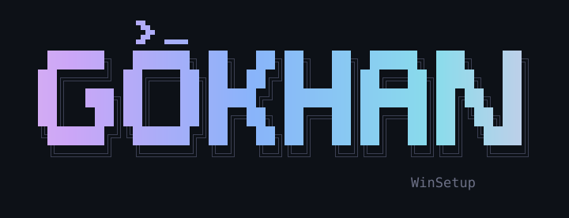

<div align="center">



<br>

 


Windows 11 için tek komutla kurulum ve sadeleştirme

</div>

## Kurulum

```powershell
irm gokhanturk.com/win | iex
```

Etkileşimsiz:

```powershell
& ([scriptblock]::Create((irm gokhanturk.com/win))) -Profile Gaming -Yes
```

Yalnızca debloat:

```powershell
irm gokhanturk.com/uninstall | iex
```

## Profiller

| Profil | İçerik |
| --- | --- |
| `Gaming` | Full debloat, Edge ve OneDrive kaldırma, oyun optimizasyonları, Steam, Firefox, mpv, geliştirici ortamı |
| `Work` | Standart debloat, OneDrive kaldırma, 7-Zip, Firefox, geliştirici ortamı |
| `VM` | Full debloat, OneDrive kaldırma, geliştirici ortamı |
| `Standard` | Standart debloat, reklam ve telemetri kapatma, 7-Zip |
| `Debloat` | Yalnızca uygulama kaldırma |
| `Neovim` | Neovim ve yapılandırması |
| `Terminal` | Yalnızca geliştirici ortamı |
| `RSAT` | AD Users and Computers, AD Sites and Services, DNS, DHCP |

**Geliştirici ortamı:** PowerShell 7, Windows Terminal, FiraCode Nerd Font, git, gh, neovim, starship, zoxide, fzf, eza, bat, ripgrep, fd, fastfetch ve [dotfiles](https://github.com/GokhanTurk/dotfiles) yapılandırmaları.

## Parametreler

| Parametre | Açıklama |
| --- | --- |
| `-Profile` | Profil adı |
| `-Level` | `Standard` veya `Full` (yalnızca `Debloat` profili) |
| `-Yes` | Onay istemeden çalışır |
| `-DryRun` | Değişiklik yapmadan planı listeler |
| `-NoLogo` | Terminal arka plan logosunu eklemez |

## Debloat seviyeleri

- **Standard:** Bing uygulamaları, Copilot, Clipchamp, LinkedIn, oyunlar gibi gereksiz uygulamalar
- **Full:** Temel araçlar (Hesap Makinesi, Not Defteri, Terminal, Store, Fotoğraflar, Paint, codec'ler) dışındaki tüm Microsoft uygulamaları

Değişiklikler mevcut ve yeni kullanıcı hesaplarına uygulanır. Kayıt dosyası: `%TEMP%\Winsetup.log`

---

<p align="center"><a href="https://gokhanturk.com"> gokhanturk.com</a></p>
