<div align="center">

# Winsetup

Windows 11 tek tıkla kurulum



</div>

## Kurulum

```powershell
irm gokhanturk.com/win | iex
```

Profil seçildikten sonra gerekirse Windows Terminal'de yönetici penceresi açılır. Uygulama kaldıran profiller Windows PowerShell 5.1'de (Appx/DISM cmdlet'leri PowerShell 7'de çalışmıyor), `Neovim` ve `Terminal` PowerShell 7'de çalışır; zaten yönetici PowerShell 7'deysen pencere açılmaz.

Sessiz (soru sormaz):

```powershell
& ([scriptblock]::Create((irm gokhanturk.com/win))) -Profile Gaming -Yes
```

```powershell
& ([scriptblock]::Create((irm gokhanturk.com/win))) -Profile Debloat -Level Full -Yes
```

Sadece debloat:

```powershell
irm gokhanturk.com/uninstall | iex
```

## Profiller

| Profil | |
| --- | --- |
| `Gaming` | Full debloat, Edge kaldırılır, oyun ayarları, Steam + Firefox + mpv, kişisel ortam |
| `Work` | Standart debloat (Edge/Teams/Outlook kalır), 7-Zip + Firefox, kişisel ortam |
| `VM` | Full debloat, kişisel ortam |
| `Standard` | Genel kullanıcı: çöp uygulamalar, reklamlar, ipuçları ve telemetri |
| `Debloat` | Sadece uygulama kaldırma |
| `Neovim` | Neovim + git + ripgrep + FiraCode Nerd Font ve config; kurulu olanlar atlanır, 0.12'den eski Neovim güncellenir |
| `Terminal` | Sadece kişisel terminal ve CLI ortamı + configler; kurulu olanlar atlanır |

**Kişisel ortam:** PowerShell 7, Windows Terminal, FiraCode Nerd Font, zoxide, starship, fzf, eza, bat, ripgrep, fd, fastfetch, git, gh, neovim + [dotfiles](https://github.com/GokhanTurk/dotfiles)

## Parametreler

| Parametre | |
| --- | --- |
| `-Profile` | `Gaming`, `Work`, `VM`, `Standard`, `Debloat`, `Neovim`, `Terminal` |
| `-Level` | `Standard` (varsayılan) veya `Full`; sadece `Debloat` profilinde |
| `-Yes` | Soru sormaz, geri yükleme noktası oluşturmaz, yeniden başlatmaz |
| `-DryRun` | Sadece yapılacakları listeler |
| `-NoLogo` | `-Yes` ile terminal arka planına BJK logosu konmaz (etkileşimli kurulumda sorulur) |

## Debloat seviyeleri

- **Standard:** Sadece çöpler (Bing uygulamaları, Solitaire, Clipchamp, Copilot, LinkedIn...). Hesap makinesi, saat, kamera, fotoğraflar, Xbox, Edge ve Store kalır.
- **Full:** Microsoft uygulamalarının neredeyse hepsi. Hesap makinesi, Notepad, Terminal, Ekran Alıntısı, Store, Fotoğraflar, Paint ve codec'ler kalır.

Uygulamalar tüm kullanıcılardan ve yeni açılacak hesaplardan kaldırılır. Log: `%TEMP%\Winsetup.log`

---

<p align="center"><a href="https://gokhanturk.com"> gokhanturk.com</a></p>
